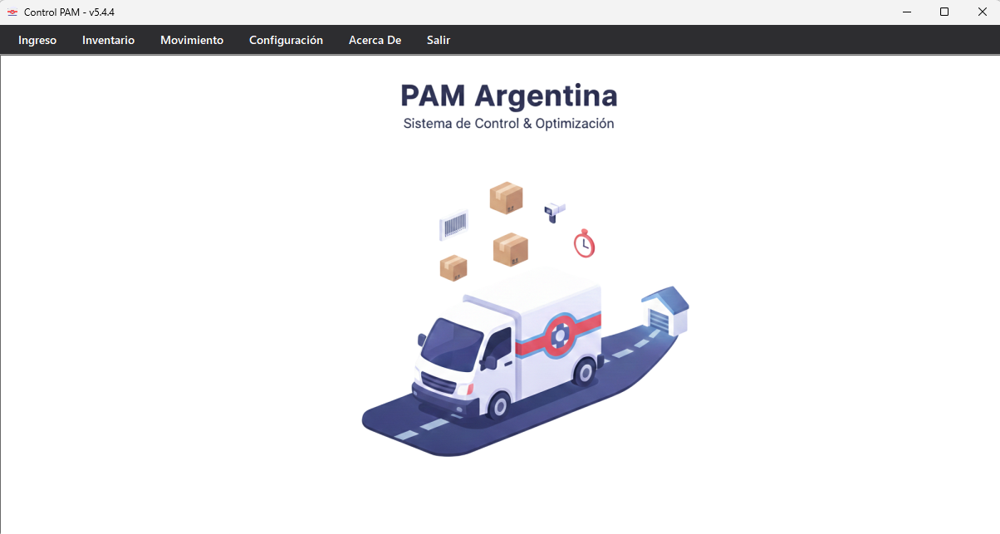

# Control — Sistema de Gestión de Inventario

  
Manual de usuario del sistema <strong>Control</strong> desarrollado para <strong>PAM Argentina</strong>: ingreso de mercadería, comparación contra anexos, exportación a Open Orange e inventarios físicos.

  

    📦 3 módulos
    🏭 5 líneas
    💻 .NET 8.0 · WinForms
  

---

## ¿Qué hace Control?

Control es una aplicación de escritorio (.NET 8.0 / WinForms) que centraliza tres flujos operativos clave:

  
📥IngresosCarga y comparación de mercadería recibida contra el anexo esperado

  
📦InventarioConteo físico de stock con descuento en tiempo real

  
🔄Movimientos BernafonDesglose de artículos de stock específico de Bernafon

---

## Flujo general de trabajo

<!--
  PLACEHOLDER GIF: Reemplazar la línea de abajo con el GIF del flujo completo
  Ejemplo: 
-->

El flujo típico de un **Ingreso de Mercadería** sigue estos pasos:

1. **Cargar el Anexo** — Pegarlo desde el portapapeles o arrastrar el archivo al sistema.
2. **Pickear la Valija** — Leer los artículos físicos con lectora de código de barras/QR.
3. **Comparar** — El sistema detecta diferencias y faltantes automáticamente.
4. **Exportar a Open Orange** — Generar la tabla final y copiarla al portapapeles.
5. **Exportar Etiquetas** — Generar el Excel de etiquetas del despacho. Ver [Exportar Etiquetas](ingresos#exportar-etiquetas).

---

## Navegación del manual

Usá la barra lateral izquierda para navegar entre módulos. También podés usar el **buscador** en la parte superior de la barra lateral.

> [!TIP]
> Los términos subrayados en azul son **enlaces internos** — hacé clic para ir directamente a esa sección.

---

## Convenciones de este manual

| Elemento    | Significado                               |
| ----------- | ----------------------------------------- |
| `Código`    | Texto que aparece tal cual en la interfaz |
| **Negrita** | Acción importante o botón clave           |
| →           | Secuencia de navegación en el menú        |
| `070-0329`  | Valor de ejemplo o código de artículo     |

---

_Para más información acerca de la aplicación ver sección [Acerca De](acerca_de.md)_
