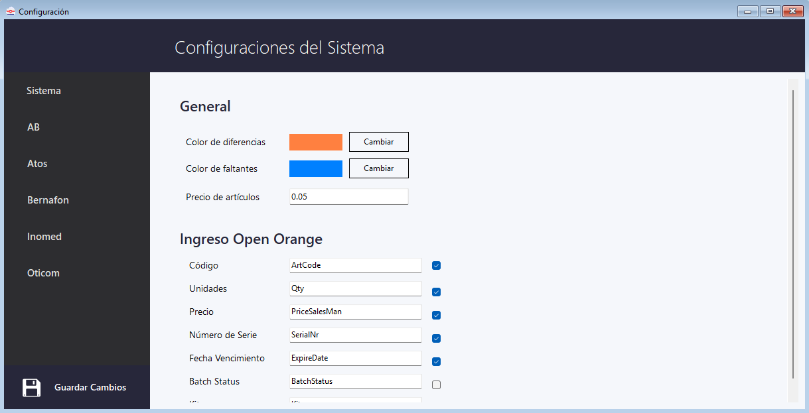
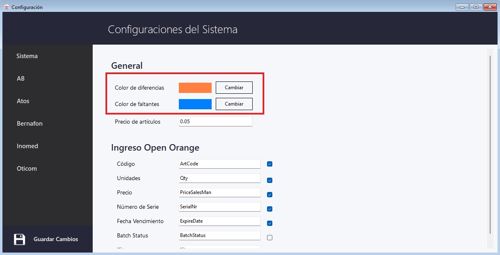
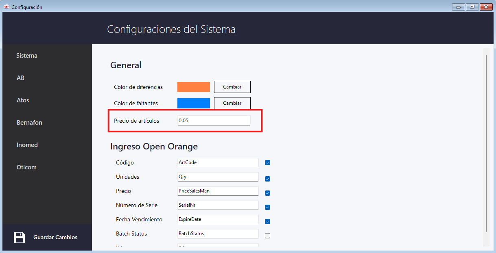
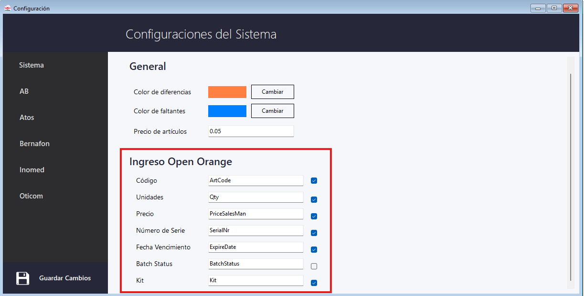
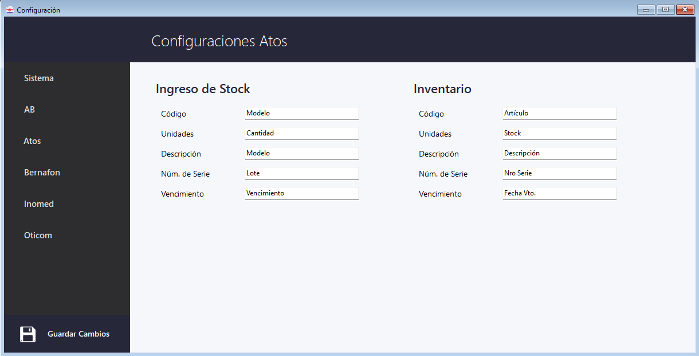
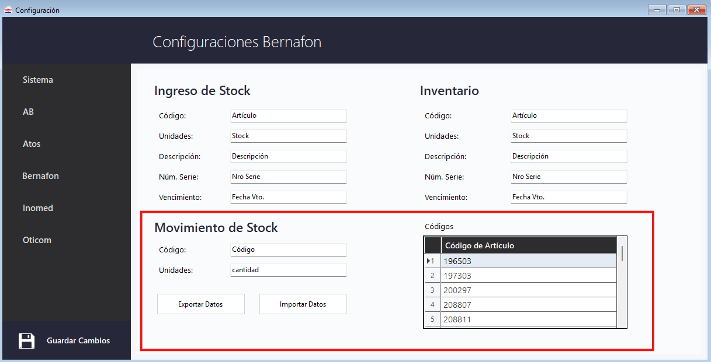
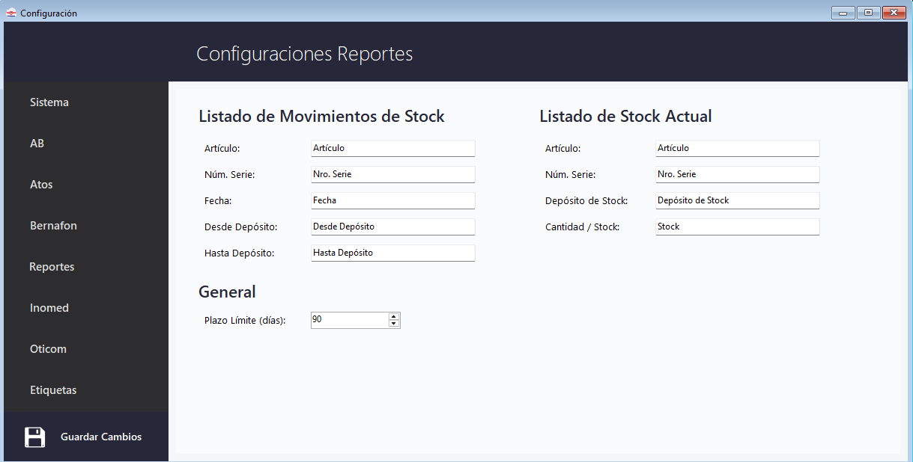

# Configuración

  
Accedé desde la barra de menú superior: <strong>Menú → Configuración</strong>.

  

    ⚙️ Menú → Configuración
    🧩 Sistema · Etiquetas · Líneas
  

La ventana de configuración tiene un **submenú lateral izquierdo** con dos tipos de entradas:

  
⚙️SistemaConfiguraciones generales que aplican a todos los módulos

  
🏷️EtiquetasExcel de etiquetas del ingreso (común a todas las líneas)

  
🏭LíneasAB, Atos, Bernafon, Inomed y Oticom — específicas por proveedor

<!-- PLACEHOLDER: Captura de la ventana de Configuración del Sistema -->

---

## Sistema (General)

En el submenú **Sistema** podés configurar:

### Colores de visualización

| Campo                    | Uso                                                                              |
| ------------------------ | -------------------------------------------------------------------------------- |
| **Color de diferencias** | Resalta filas con cantidad, número de serie o vencimiento distinto a lo esperado |
| **Color de faltantes**   | Resalta artículos presentes en el Anexo pero no encontrados en la Valija         |

Hacé clic en **Cambiar** para abrir el selector de color.

### Precio de artículos

El campo **Precio de artículos** define el valor por defecto con el que se exportará a Open Orange (ej. `0.05`).

### Ingreso Open Orange — Mapeo de columnas

Esta sección configura los **nombres de las columnas** del archivo que se enviará a Open Orange.  
Cada fila tiene el nombre interno del sistema y el nombre de columna destino editable.

| Campo interno     | Columna destino (editable) | Incluir |
| ----------------- | -------------------------- | ------- |
| Código            | ArtCode                    | ✅      |
| Unidades          | Qty                        | ✅      |
| Precio            | PriceSalesMan              | ✅      |
| Número de Serie   | SerialNr                   | ✅      |
| Fecha Vencimiento | ExpireDate                 | ✅      |
| Batch Status      | BatchStatus                | ☐       |
| Kit               | Kit                        | ✅      |

> [!INFO]
> El campo **Kit** sólo es relevante para valijas de AB. Si está habilitado, aparecerá el textBox de **Serie Procesador** en la tab Valija durante el Ingreso. Ver [Tab Valija en Ingresos](ingresos#tab-valija).

Hacé clic en **Guardar Cambios** (ícono de disquete) para confirmar.

---

## Etiquetas

En el submenú **Etiquetas** se configura el Excel que genera el botón [Exportar Etiquetas](ingresos#exportar-etiquetas) durante el Ingreso de Mercadería. La configuración es común a todas las líneas.

<!-- PLACEHOLDER: Captura de Configuraciones Etiquetas -->

### Columnas del Excel

Igual que en Open Orange, cada columna tiene un nombre editable y un checkbox de inclusión:

| Columna  | Nombre por defecto | Incluir |
| -------- | ------------------ | ------- |
| Código   | Código             | ✅      |
| Serie    | Serie              | ✅      |
| Cantidad | Cantidad           | ✅      |
| Despacho | Despacho           | ✅      |

> [!WARNING]
> Dejá activo **al menos una** columna: si todas están excluidas, la exportación falla con un mensaje de error.

### Carpeta y nombre del archivo

| Campo                      | Uso                                                                        |
| -------------------------- | -------------------------------------------------------------------------- |
| **Carpeta de exportación** | Destino fijo del archivo. El botón **Examinar...** abre el selector de carpetas |
| **Nombre del archivo**     | Nombre con el que se guarda el `.xlsx`, tal cual se escriba                |

El comportamiento depende de si hay carpeta configurada:

- **Con carpeta**: el sistema guarda directo en esa ruta, sin preguntar nada.
- **Sin carpeta**: en cada exportación se abre el diálogo de guardado, con el nombre precargado como sugerencia.

> [!WARNING]
> El nombre se usa **exactamente como se escribe** (más la extensión `.xlsx`) porque ese archivo es consumido por otro sistema. No le agregues línea, fecha ni despacho. Los caracteres inválidos (`\ / : * ? " < > |`) se remueven automáticamente.

Hacé clic en **Guardar Cambios** (ícono de disquete) para confirmar.

---

## Configuración por Línea

Todas las líneas (excepto Bernafon) comparten el mismo esquema de configuración. Se pueden definir los nombres de columna para dos contextos:

- **Ingreso de Stock** — columnas del archivo de anexo al recibir mercadería.
- **Inventario** — columnas del archivo de stock exportado desde Open Orange.

<!-- PLACEHOLDER: Captura de Configuraciones Atos -->

**Ejemplo para Atos:**

| Contexto   | Campo         | Nombre de columna |
| ---------- | ------------- | ----------------- |
| Ingreso    | Código        | Modelo            |
| Ingreso    | Unidades      | Cantidad          |
| Ingreso    | Descripción   | Modelo            |
| Ingreso    | Núm. de Serie | Lote              |
| Ingreso    | Vencimiento   | Vencimiento       |
| Inventario | Código        | Articulo          |
| Inventario | Unidades      | Stock             |
| Inventario | Descripción   | Descripción       |
| Inventario | Núm. de Serie | Nro Serie         |
| Inventario | Vencimiento   | Fecha Vto.        |

> [!WARNING]
> Estos nombres deben coincidir **exactamente** con los encabezados del archivo de anexo. El sistema busca esos encabezados en las primeras **20 filas** del archivo al cargarlo.

---

## Configuración Bernafon

Bernafon tiene una sección adicional: **Movimiento de Stock**, que incluye:

- **Código** — nombre de la columna de código de artículo en el movimiento.
- **Unidades** — nombre de la columna de cantidad.
- **Códigos de Artículo** — lista de códigos que se desglosan automáticamente al importar un movimiento.

<!-- PLACEHOLDER: Captura de Configuraciones Bernafon -->

Podés **exportar e importar** la lista de códigos con los botones **Exportar Datos** / **Importar Datos**.

> [!TIP]
> Si recibís un movimiento con un código que no está en esta lista, podés desglosarlo manualmente con doble clic. Ver [Movimientos Bernafon](movimientos-bernafon#desglosar-un-articulo).

---

## Reportes

En el submenú **Reportes** se configura el [Reporte Bernafon](reporte_bernafon): los nombres de las columnas de los archivos de entrada y el plazo límite.

<!-- PLACEHOLDER: Captura de Configuraciones Reportes -->

### Nombres de columnas

Cada archivo de entrada tiene sus propios nombres de columna:

| Excel de entrada             | Campos a configurar                                              |
| ---------------------------- | --------------------------------------------------------------- |
| **Listado de Movimientos**   | Artículo, Núm. Serie, Fecha, Desde Depósito, Hasta Depósito      |
| **Listado de Stock Actual**  | Artículo, Núm. Serie, Depósito de Stock, Cantidad / Stock        |

> [!WARNING]
> Estos nombres deben coincidir **exactamente** con los encabezados de los archivos. Si no coinciden, el reporte no se puede generar.

### Plazo límite

El campo **Plazo Límite (días)** (por defecto `30`) define el máximo de días que una serie puede estar en consignación:

- **Dentro del plazo** → la serie figura como **Consignación en Plazo**.
- **Supera el plazo** → la serie figura como **Consignación Vencida**.

Hacé clic en **Guardar Cambios** (ícono de disquete) para confirmar.
