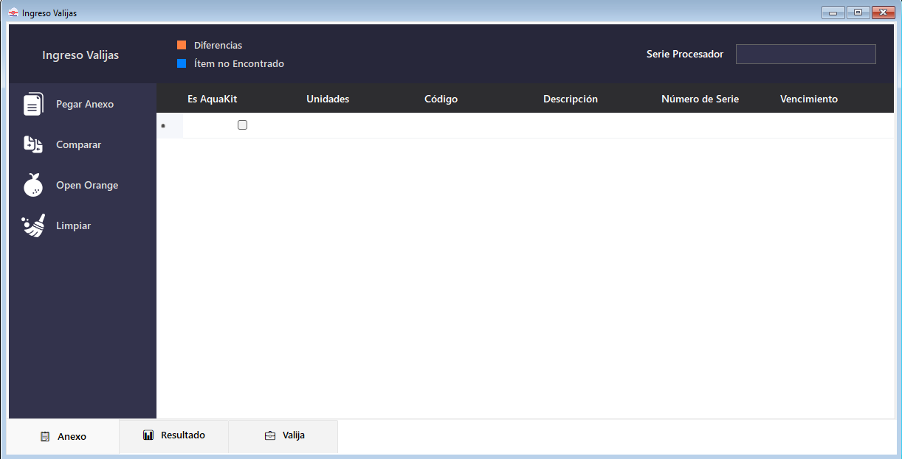
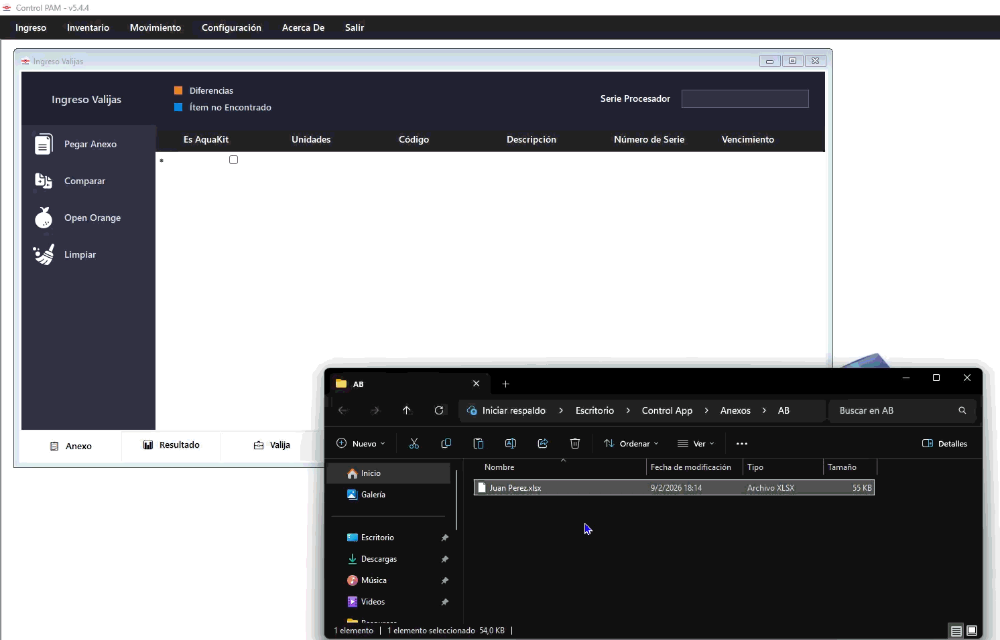
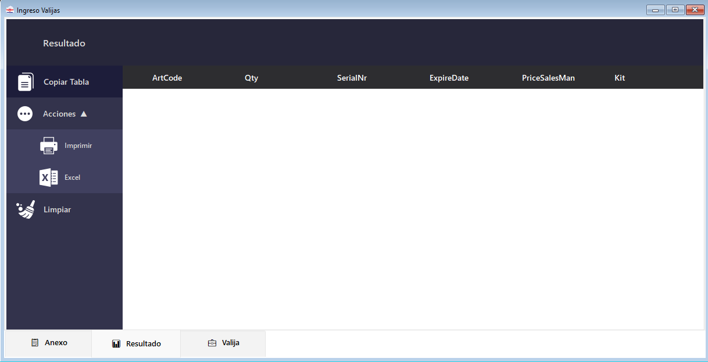
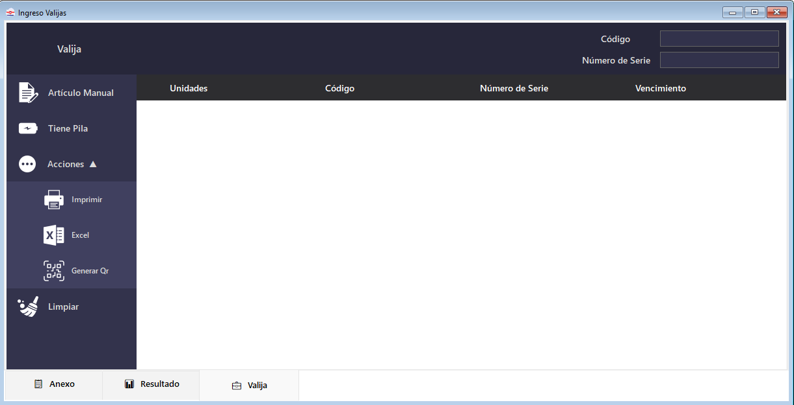
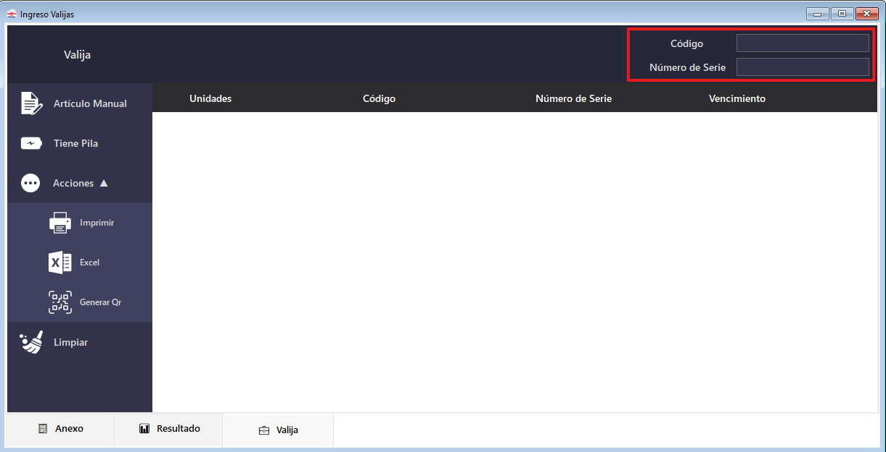
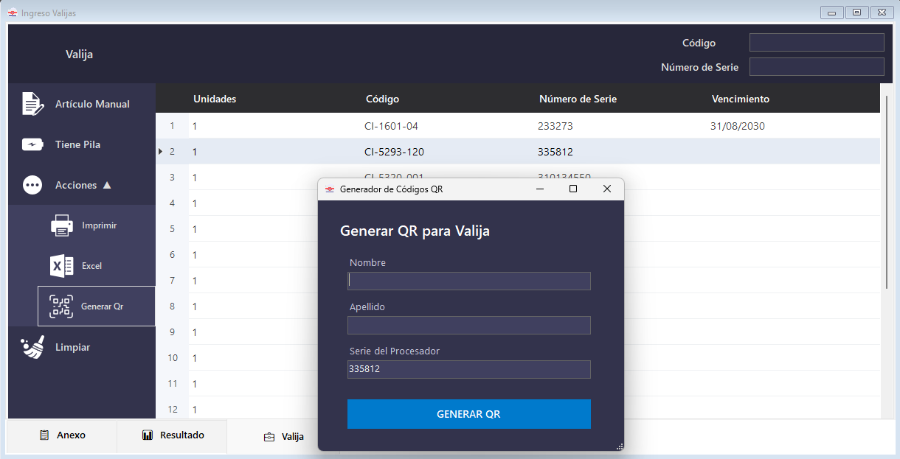
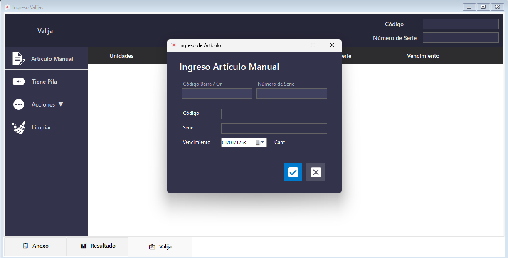

# Ingreso de Mercadería

  
El módulo de <strong>Ingresos</strong> se accede desde la barra de menú superior: <strong>Ingreso → [Línea]</strong>.

  

    📥 Módulo de Ingresos
    🏭 AB · Atos · Bernafon · Inomed · Oticom
    🗂️ 3 tabs
  

Si bien todas las ventanas de ingreso tienen el mismo formato base, pueden presentar pequeñas diferencias según la línea seleccionada. Todas comparten **tres tabs** en la parte inferior:

  
📋AnexoTabla del anexo (mercadería esperada según el remito)

  
📤ResultadoGenera la tabla final para exportar a Open Orange

  
🧳ValijaCarga de los artículos físicos recibidos

<!-- PLACEHOLDER: GIF del flujo completo de ingreso -->

---

## Tab Anexo

Esta tab es el **punto de partida** del proceso de ingreso. Desde el submenú lateral izquierdo disponés de las siguientes acciones:

### Pegar Anexo

Copiá el contenido del anexo (incluyendo el encabezado de la tabla) y hacé clic en **Pegar Anexo**. El sistema detectará automáticamente las columnas configuradas.

También podés **arrastrar el archivo directamente** a la ventana (drag & drop). Esto funciona con **múltiples archivos a la vez** — todos se cargarán juntos.

> [!INFO]
> Al soltar el archivo, el sistema busca los encabezados configurados en las primeras **20 filas**. Si no los encuentra, verificá la configuración en [Configuración por Línea](configuracion#configuracion-por-linea).

<!-- PLACEHOLDER: GIF del drag & drop del anexo -->

### Comparar

Una vez cargado el Anexo **y** los artículos físicos en la [Tab Valija](#tab-valija), hacé clic en **Comparar** para confrontar ambas listas.

El sistema resaltará las filas con los colores configurados:

- Color diferencias — artículo encontrado pero con diferencias, ya sea en cantidad, número de serie o vencimiento.
- Color faltantes — artículo del Anexo no encontrado en la Valija.

En cualquiera de los dos casos, el sistema indica el motivo de la diferencia. Para ello, coloque el cursor sobre la fila resaltada con color.

### Open Orange

Luego de comparar, hacé clic en **Open Orange** para generar la tabla de exportación. Esto prepara la información para la [Tab Resultado](#tab-resultado).

### Limpiar

Borra toda la información cargada en esta tab. No afecta a las otras tabs.

### Despacho

Campo ubicado en la parte superior derecha de esta tab. Cargá acá el número de despacho del ingreso: es **obligatorio** para poder usar [Exportar Etiquetas](#exportar-etiquetas) y viaja como columna en ese Excel.

> [!INFO]
> El valor aplica a toda la sesión: todas las filas del Excel de etiquetas salen con este número.

### Serie Procesador _(solo AB con Kit habilitado)_

Si en **Configuración → Ingreso Open Orange** la opción **Kit** está activa, aparece un campo debajo de **Despacho** (parte superior derecha) para ingresar el número de serie del procesador de la valija. Este valor se incluye en la exportación a Open Orange.

---

## Tab Resultado

Muestra la **tabla final** que se usará para el ingreso en Open Orange.

<!-- PLACEHOLDER: Captura de Tab Resultado con datos -->

Acciones disponibles:

- **Copiar Tabla** — copia al portapapeles, listo para pegar en Open Orange.
- **Acciones ▲** — menú desplegable:
  - **Imprimir** — envía la tabla a impresora.
  - **Excel** — exporta como archivo `.xlsx`.
- **Limpiar** — vacía la tabla del resultado.

---

## Tab Valija

Es donde se registran los **artículos físicos recibidos**. Podés cargarlos de dos formas:

### Pickeo con lectora (modo normal)

1. Hacé clic en el textBox **Código** para enfocar el cursor.
2. Leé el código de barras o QR del artículo con la lectora.
3. Dependiendo de la línea, se leerá también el **Número de Serie** (AB tiene 2 campos; Atos tiene 1 campo unificado).
4. El sistema completa la tabla dinámicamente a medida que pickeás.

<!-- PLACEHOLDER: GIF del pickeo con lectora -->

### Artículo Manual

Para cargar artículos sin lectora, o para ingresar muchas unidades de un mismo artículo. Ver [Artículo Manual](#articulo-manual).

### Tiene Pila _(solo AB)_

Agrega automáticamente un artículo de pila con datos predefinidos:

| Campo           | Valor      |
| --------------- | ---------- |
| Código          | `070-0329` |
| Número de serie | `150650`   |

### Acciones ▲

- **Imprimir** — imprime el contenido de la Valija.
- **Excel** — exporta como `.xlsx`.
- **Generar QR** — genera un código QR con toda la información de la valija para pickeo posterior. Ver [Generación de QR](#generacion-de-qr).

---

## Exportar Etiquetas

El botón **Exportar Etiquetas** está en el submenú lateral de la [Tab Anexo](#tab-anexo) y genera un Excel con las etiquetas del ingreso.

<!-- PLACEHOLDER: Captura del botón Exportar Etiquetas / Excel generado -->

A diferencia de las otras exportaciones, **no exporta una tabla de la pantalla**: acumula durante toda la sesión todo lo que fue pickeando en la [Tab Valija](#tab-valija) (incluyendo [Artículo Manual](#articulo-manual) y Tiene Pila) y lo vuelca al final.

| Columna  | Contenido                                          |
| -------- | -------------------------------------------------- |
| Código   | Código del artículo                                |
| Serie    | Número de serie                                    |
| Cantidad | Unidades recibidas (agrupadas por código y serie)  |
| Despacho | Número de despacho cargado en el campo **Despacho** |

Los nombres de columna y su inclusión se configuran en [Configuración → Etiquetas](configuracion#etiquetas).

### Flujo de exportación

1. Cargá el número de despacho en el campo **Despacho** de la Tab Anexo.
2. Piqueá la valija normalmente.
3. Hacé clic en **Exportar Etiquetas**. El sistema muestra el spinner **"Exportando etiquetas..."** mientras genera el archivo en segundo plano.
4. Si tenés **Carpeta de exportación** configurada, el archivo se guarda directo ahí. Si no, se abre el diálogo para elegir dónde guardarlo.
5. Al terminar, el sistema pregunta si querés abrir el archivo.

> [!WARNING]
> Si hay carpeta configurada, el archivo siempre se guarda con el nombre definido en **Nombre del archivo** — cada exportación **reemplaza al anterior**, ya que ese archivo es consumido por otro sistema.

> [!TIP]
> La exportación se bloquea con un aviso si falta cargar el **Despacho** o si no pickeaste ningún artículo. Los botones **Limpiar** de las tabs reinician también el acumulador de etiquetas.

---

## Generación de QR _(solo Valijas de AB)_

Desde la [Tab Valija](#tab-valija), en **Acciones ▲ → Generar QR** se abre el **Generador de Códigos QR**.

<!-- PLACEHOLDER: Captura del diálogo Generar QR para Valija -->

Los campos disponibles son:

| Campo                    | Descripción                                                  | Obligatorio |
| ------------------------ | ------------------------------------------------------------ | ----------- |
| **Nombre**               | Nombre del paciente                                          | No          |
| **Apellido**             | Apellido del paciente                                        | No          |
| **Serie del Procesador** | Se autocompleta con el Nro. de Serie de la fila seleccionada | No          |

> [!TIP]
> El campo **Serie del Procesador** se autocompleta automáticamente con el número de serie de la fila que estaba seleccionada en la tabla al momento de abrir la ventana.

Hacé clic en **GENERAR QR** para continuar. El sistema pedirá opciones de impresión y mostrará una **vista previa** con:

- Nombre del paciente (PACIENTE: **JUAN PEREZ**)
- Número de serie
- Código QR escaneable

En la vista previa, hacé clic en el **ícono de impresora** (primer ícono de la barra) para imprimir.

---

## Artículo Manual

Se abre desde la [Tab Valija](#tab-valija) con el botón **Artículo Manual** del submenú lateral.

<!-- PLACEHOLDER: Captura de la ventana Artículo Manual -->

La ventana tiene dos secciones:

### Ingreso por lectora

| Campo                 | Descripción                                           |
| --------------------- | ----------------------------------------------------- |
| **Código Barra / QR** | Leer con lectora (decodifica automáticamente)         |
| **Número de Serie**   | Campo adicional para líneas que lo requieren (ej. AB) |

> Para Atos, aparece un único campo unificado.

### Ingreso manual

| Campo           | Descripción                         |
| --------------- | ----------------------------------- |
| **Código**      | Código del artículo                 |
| **Serie**       | Número de serie                     |
| **Vencimiento** | Fecha de vencimiento (`dd/mm/aaaa`) |
| **Cantidad**    | Unidades a ingresar                 |

Confirmá con ✔ o cancelá con ✗.

**Casos de uso habituales:**

- Ingresar **muchas unidades** de un mismo artículo: leés el código una vez y modificás la cantidad manualmente.
- Registrar una **caja con contenido parcial** sin tener que pickear unidad por unidad.
