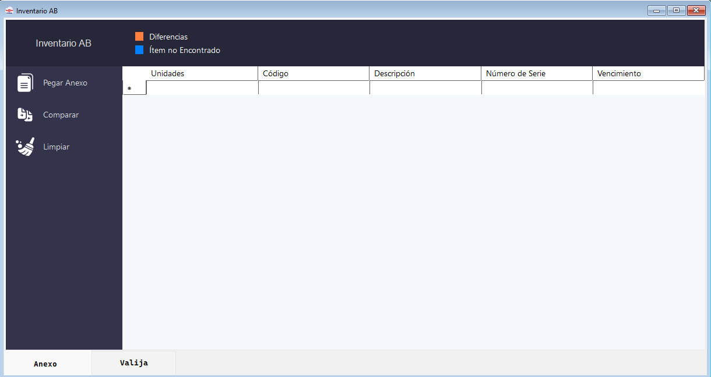
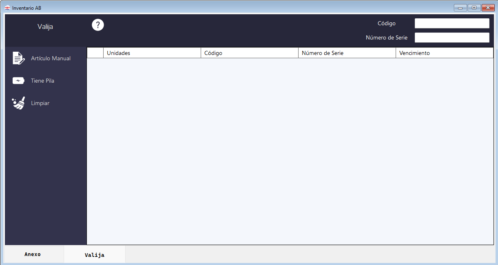

# Inventario

  
El módulo de <strong>Inventario</strong> se accede desde <strong>Inventario → [Línea]</strong> en la barra de menú.

  

    📦 Módulo de Inventario
    🏭 AB · Atos · Bernafon · Inomed · Oticom
    🗂️ 2 tabs
  

> [!INFO]
> Esta funcionalidad se encuentra actualmente en migración de interfaz gráfica para mejorar el aspecto visual de las ventanas destinadas al inventario.

La interfaz es muy similar a la de [Ingresos](ingresos), pero con un flujo diferente: en lugar de comparar contra lo _recibido_, se compara contra el _stock actual_ exportado desde Open Orange.

Cuenta con **dos tabs**:

  
📋AnexoListado de stock esperado (importado desde Open Orange)

  
🧳Valija (Físico)Artículos físicos que se van pickeando durante el conteo

---

## Tab Anexo

<!-- PLACEHOLDER: Captura de la ventana de Inventario - Tab Anexo -->

### Pegar Anexo

Cargá el listado de stock desde Open Orange. Podés copiarlo al portapapeles y hacer clic en **Pegar Anexo**, o **arrastrar el archivo** directamente a la ventana.

> [!INFO]
> El sistema busca los encabezados configurados en las primeras **20 filas** del archivo. Verificá la configuración en [Configuración por Línea](configuracion#configuracion-por-linea) si hay problemas.

### Comparar

A diferencia de Ingresos, en Inventario la comparación funciona de manera **continua**:

- Cada artículo pickeado en la tab **Físico** se **descuenta** del Anexo en tiempo real.
- Esto permite realizar el conteo **por lotes de pickeo** sin perder el estado.
- Los artículos pickeados que **no estén en el Anexo** se marcan en **color gris**.

Al terminar el inventario, los artículos que queden en la tab Físico sin correspondencia en el Anexo representan el **remanente** (stock físico extra no registrado).

### Generar Reporte

Genera un reporte completo con:

- Todos los artículos del Anexo.
- Los artículos pickeados.
- Las diferencias entre ambos.

### Limpiar

Vacía la información del Anexo. No afecta la tab Físico.

---

## Tab Valija

Funciona igual que en [Ingresos - Tab Valija](ingresos#tab-valija), con las mismas opciones de carga:

- **Artículo Manual** — carga manual. Ver [Artículo Manual](ingresos#articulo-manual).
- **Tiene Pila** _(solo AB)_ — agrega pila predefinida (`070-0329` / `150650`).
- **Limpiar** — vacía la tab.

<!-- PLACEHOLDER: Captura de la ventana de Inventario - Tab Físico con datos -->

> [!TIP]
> Podés pickear **por lotes**: pickear un grupo de artículos, hacer **Comparar**, y continuar con el siguiente grupo. El sistema acumula los resultados.
