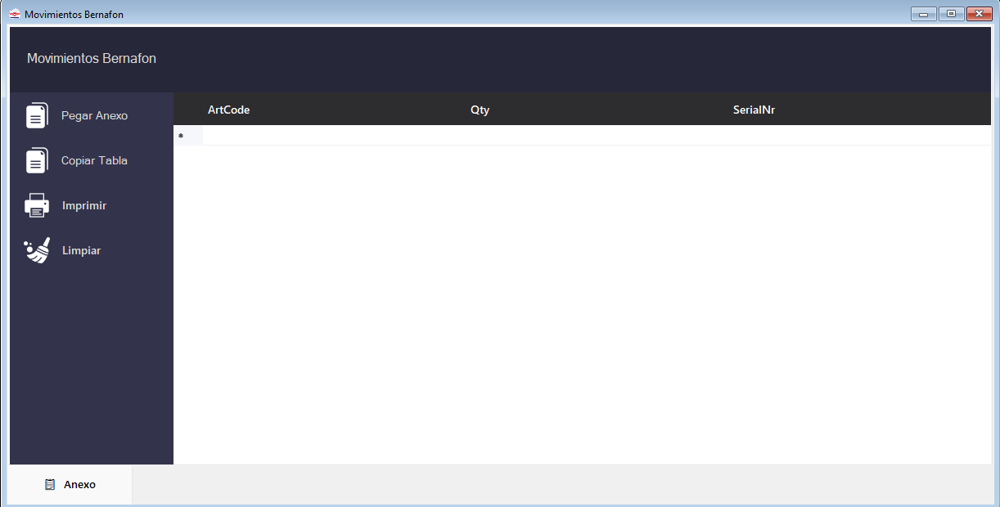
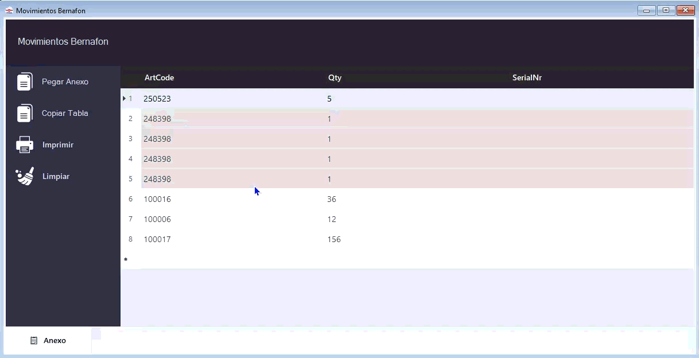

# Movimientos Bernafon

  
Este módulo es <strong>exclusivo de la línea Bernafon</strong> y se accede desde <strong>Movimiento → Bernafon</strong> en la barra de menú.

  

    🔄 Exclusivo Bernafon
    🗂️ 1 tab (Anexo)
    🧩 Desglose automático
  

A diferencia del módulo de Ingresos, la ventana de Movimientos tiene **una sola tab** (Anexo) y está diseñada para gestionar el desglose de artículos compuestos (audífonos + cargadores).

<!-- PLACEHOLDER: Captura de la ventana Movimientos Bernafon vacía -->

---

## Funciones principales

### Pegar Anexo

Copiá la tabla del movimiento y hacé clic en **Pegar Anexo**. También podés **arrastrar el archivo** directamente a la ventana.

Al importar, el sistema **desglosará automáticamente** los códigos configurados en [Configuración → Bernafon → Movimiento de Stock](configuracion#configuracion-bernafon).

También podés **arrastrar el archivo directamente** a la ventana (drag & drop). Esto funciona con **múltiples archivos a la vez** — todos se cargarán juntos.

> [!INFO]
> Al soltar el archivo, el sistema busca los encabezados configurados en las primeras **20 filas**. Si no los encuentra, verificá la configuración en [Configuración → Bernafon → Movimiento de Stock](configuracion#configuracion-bernafon).

### Copiar Tabla

Una vez completados los números de serie de audífonos y cargadores, hacé clic en **Copiar Tabla** para copiar el resultado al portapapeles, listo para pegar en Open Orange.

### Limpiar

Vacía toda la información de la tab.

---

## Desglosar un Artículo

Si un código del movimiento **no está configurado** para desglose automático, aparecerá como una sola fila agrupada. Para desglosarlo manualmente:

<!-- PLACEHOLDER: GIF del proceso de doble clic y desglose -->

**Paso a paso:**

1. Localizá la fila con el código sin desgloses (ej. código `250523` con Qty `5`).
2. Hacé **doble clic** en el cabezal (número de fila) de esa fila.
3. Aparece el diálogo: _"Se desglosará el código 250523. ¿Desea continuar?"_
4. Hacé clic en **Sí**.
5. El sistema expande el código en tantas filas individuales como unidades indicaba la Qty (en el ejemplo, 5 filas con Qty = 1 cada una).

> [!TIP]
> Para que el desglose funcione automáticamente en el futuro, agregá el código a la lista en [Configuración → Bernafon](configuracion#configuracion-bernafon) y guardá los cambios.

> [!WARNING]
> El desglose no puede deshacerse en la misma sesión. Si lo hiciste por error, hacé clic en **Limpiar** y volvé a importar el anexo.
