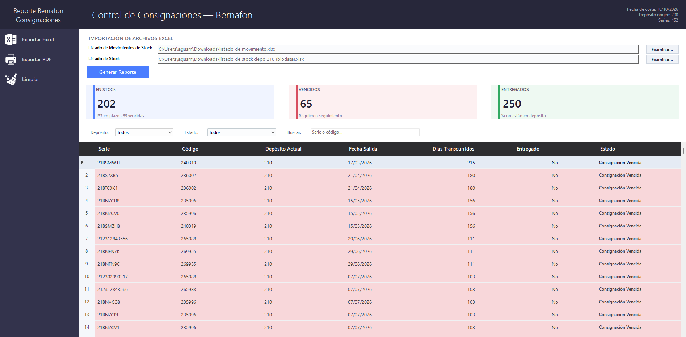

# Reporte Bernafon

  
El módulo de <strong>Reportes</strong> se accede desde la barra de menú superior: <strong>Reportes → Bernafon</strong>.

  

    📊 Exclusivo Bernafon
    🔎 Control de consignaciones
    🏭 Origen: Depósito Central (200)
  

Este reporte muestra **dónde está cada número de serie** de la mercadería enviada en consignación desde el **Depósito Central (200)** hacia los distribuidores, y **cuánto tiempo** lleva fuera de depósito.

<!-- PLACEHOLDER: Captura de la ventana "Control de Consignaciones - Bernafon" con un reporte generado (cards, filtros y grilla con datos) -->

---

## ¿Para qué sirve?

Cruzando dos archivos Excel, el sistema clasifica cada número de serie en uno de tres estados:

  
🟡En PlazoSigue en el distribuidor y no superó el plazo

  
🔴VencidaSigue en el distribuidor y ya superó el plazo

  
🟢EntregadoYa no figura en stock (se vendió o entregó)

---

## Cómo generar el reporte

1. En **Listado de Movimientos de Stock**, hacé clic en **Examinar...** y elegí el archivo.
2. En **Listado de Stock**, repetí el paso anterior y elegí el segundo archivo.
3. Hacé clic en **Generar Reporte**.

Al terminar, el sistema muestra el **Resumen**, los **filtros** y la **grilla** con toda la información.

> [!INFO]
> El resultado se ordena por **criticidad**: primero las **Vencidas**, después las **En Plazo** y al final las **Entregadas**.

---

## Estados y colores

| Estado | Significado | Color de fila |
| ------------------------ | ---------------------------------------------------- | ------------- |
| **Consignación en Plazo** | Está en el distribuidor y no superó el plazo.         | Amarillo      |
| **Consignación Vencida** | Está en el distribuidor y ya superó el plazo.         | Rojo          |
| **OK - Entregado**       | Ya no está en stock (se vendió o entregó).            | Verde         |

> [!INFO]
> Si una serie figura en el stock pero **no tiene un movimiento registrado**, se considera **Vencida** y se resalta con un **color claro** distinto del rojo, para poder identificarla fácilmente.

---

## Resumen, filtros y búsqueda

- **Tarjetas de resumen:** **EN STOCK**, **VENCIDOS** y **ENTREGADOS**. Hacé clic en una tarjeta para ver solo ese grupo; volvé a hacer clic para ver todo de nuevo.
- **Filtros:** **Depósito** y **Estado** se combinan entre sí.
- **Buscar:** escribí un número de serie o un código para filtrar al instante.

---

## Exportar

- **Exportar Excel** y **Exportar PDF** generan un archivo con **solo lo que se ve en pantalla** (respetando los filtros aplicados).
- El nombre sugerido es `Reporte_Bernafon_AAAAMMDD`.
- **Limpiar** borra los archivos, los filtros y el resultado.

> [!TIP]
> Como la exportación respeta los filtros, podés generar un Excel únicamente con las **consignaciones vencidas** de un distribuidor.

---

## Configuración

Los nombres de las columnas de cada Excel y el **plazo límite** se ajustan desde [Configuración → Reportes](configuracion#reportes).
